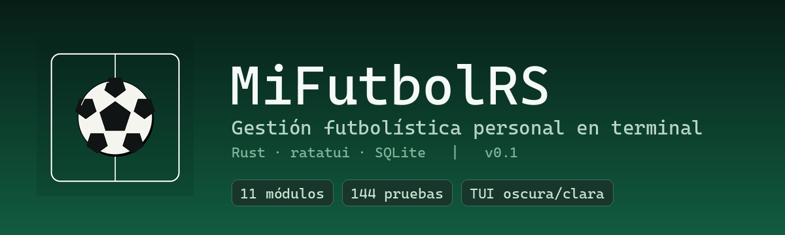
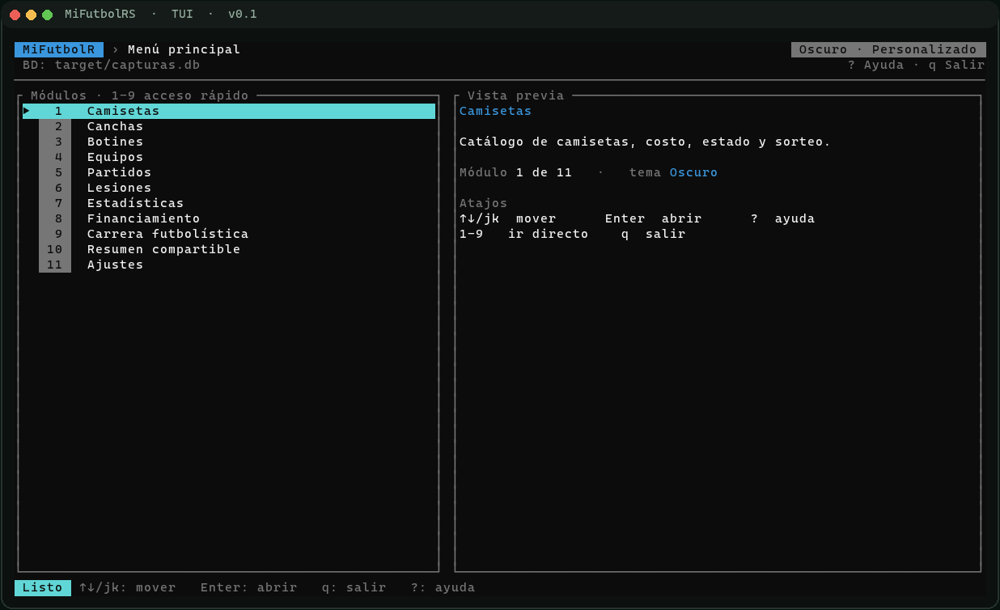
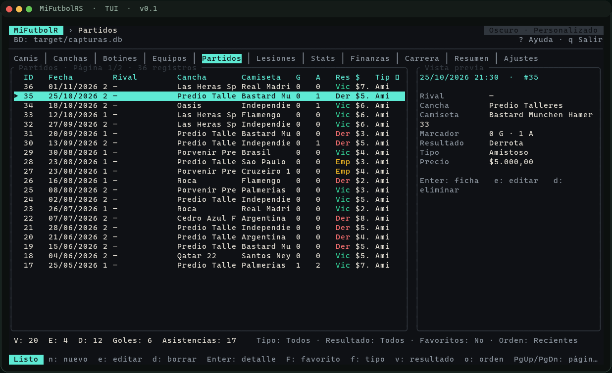
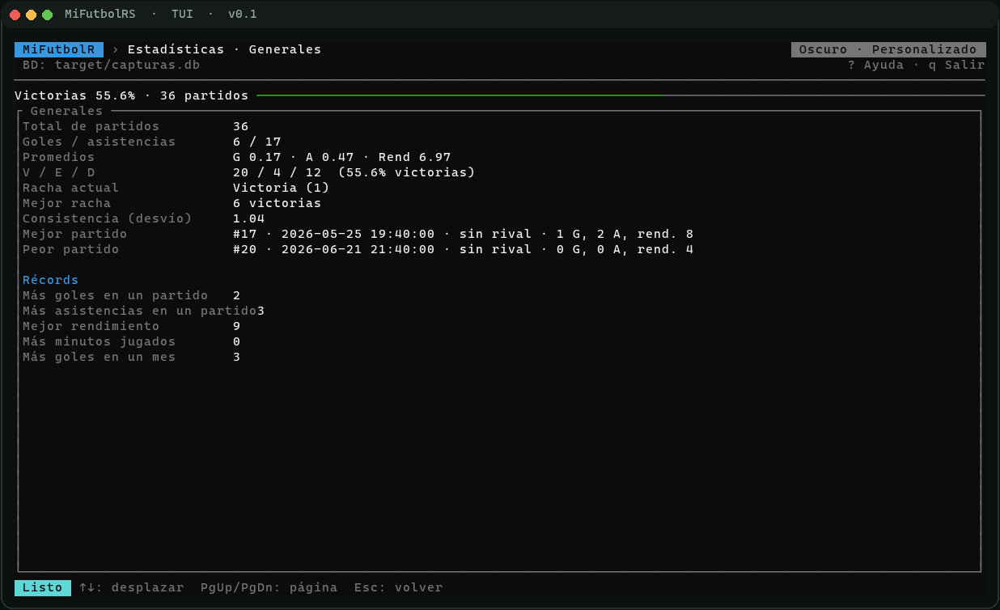
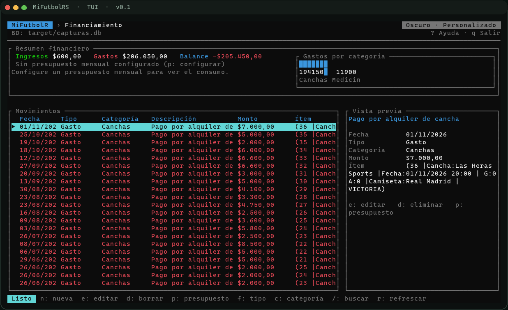

# MiFutbolR · v0.1



Gestión futbolística personal en terminal (Rust 2024 + rusqlite + ratatui).
Implementa la especificación de `skills/ESPECIFICACION_PROYECTO_RUST_TUI.md`
aplicando las prácticas de `skills/Performance.md`.

## Capturas

| Menú principal | Partidos con vista previa |
|---|---|
|  |  |
| **Estadísticas** | **Financiamiento** |
|  |  |

Las capturas se generan desde la TUI real con
`cargo run --example capturar_tui` y `python scripts/render_capturas.py`.

## Características

- **11 módulos**: Camisetas, Canchas, Botines, Equipos, Partidos, Lesiones,
  Estadísticas, Financiamiento, Carrera, Resumen Compartible y Ajustes.
- **TUI ratatui**: header con breadcrumb, tablas con vista previa lateral,
  formularios con iconos de tipo, wizard de partidos en 4 pasos, modales,
  temas, búsqueda incremental y barra de estado.
- **SQLite embebido**: migraciones `PRAGMA user_version`, WAL, claves foráneas,
  índices y seeds.
- **Partidos**: filtros, paginación, favoritos, derivados y transacción
  financiera automática.
- **Estadísticas**: generales, series, 20 métricas de rendimiento, canchas,
  goles/asistencias, sparkline y `LineGauge`/`BarChart`.
- **Carrera**: identidad, hitos, rachas, badges, timeline, Hall of Fame,
  perfil dinámico, modo retro y logros.
- **Resumen Compartible**: Markdown/HTML/texto con vista previa y exportación.
- **Ajustes**: tema, idioma, modo, tamaño, visor, botín predeterminado, backup,
  exportación, integridad y restauración en vivo.
- **Migración legacy**: importa una base de MiFutbolC convirtiendo fechas,
  importes y códigos de cancha; ignora tablas vacías/no usadas como `amigo`.

## Instalación en Windows

El instalador está en `dist/MiFutbolR-Setup-0.1.exe` (Inno Setup):

- Instala MiFutbolR en `{autopf}\MiFutbolR` (Program Files).
- Crea un acceso directo en el **menú Inicio**.
- Permite crear opcionalmente un acceso directo en el **escritorio**.
- Usa el icono `assets/icono.ico`.
- Permite **iniciar el programa** al finalizar la instalación.
- Incluye el **desinstalador** de Windows.

La base de datos de usuario se guarda en
`%LOCALAPPDATA%\mifutbol\mifutbol-rs\data\mifutbol.db` y no se elimina al
desinstalar.

Para migrar una base legacy:

```powershell
.\mifutbol-rs.exe --importar-legacy "C:\ruta\mifutbol.db"
```

o desde la TUI: **Ajustes → Ctrl+L**. Detalle en
[`docs/MIGRACION_BD.md`](docs/MIGRACION_BD.md).

## Requisitos

- Rust estable (probado con 1.99; edición 2024, MSRV 1.85).
- Toolchain C para SQLite embebido (MSVC Build Tools en Windows).

## Comandos

```bash
cargo run                    # abre la TUI (crea la BD si no existe)
cargo test                   # unitarias + integración
cargo nextest run            # pruebas con nextest
cargo clippy --all-targets -- -D warnings
cargo fmt --check
cargo build --release        # opt-level 3, lto thin, strip
cargo bench --bench queries  # benchmarks de consultas
cargo audit                  # vulnerabilidades
cargo deny check             # licencias/bans (deny.toml)
cargo bloat --release --crates
cargo expand --lib
```

### Análisis completo

[`scripts/analizar.ps1`](scripts/analizar.ps1) ejecuta todo el toolchain y
genera logs + reporte en `target/analisis/`:

```powershell
.\scripts\analizar.ps1              # análisis rápido
.\scripts\analizar.ps1 -Completo    # pruebas release + audit/deny/bloat/expand
```

Última ejecución: **17 pasos, 0 fallos**; 144 pruebas; `cargo audit` y
`cargo deny` sin hallazgos.

## Datos

| SO | Ruta por defecto |
|----|------------------|
| Windows | `%LOCALAPPDATA%\mifutbol\mifutbol-rs\data\mifutbol.db` |
| Linux | `~/.local/share/mifutbol-rs/mifutbol.db` |
| macOS | `~/Library/Application Support/com.mifutbol.mifutbol-rs/mifutbol.db` |

`MIFUTBOL_DB` permite apuntar a otro archivo. Exportaciones, backups e
imágenes viven junto a la BD.

## Arquitectura

```
ui (ratatui) → app (pantallas/teclado/estado) → services (reglas) → db (SQL)
                              domain (modelos, dinero, fechas, stats, plantillas)
```

- Dinero en centavos (`Cents`); fechas ISO en BD y `DD/MM/YYYY` en UI.
- La UI nunca ejecuta SQL ni lógica de negocio.
- PRAGMAs: `foreign_keys=ON`, `journal_mode=WAL`, `synchronous=NORMAL`,
  `temp_store=MEMORY`.

## Calidad y rendimiento

- **144 pruebas** verdes (nextest: 144 passed en ~2 s).
- `clippy --all-targets -- -D warnings` y `cargo fmt --check` limpios.
- CI multiplataforma (Ubuntu, Windows, macOS): fmt, clippy, tests y release.
- Benchmarks Criterion sobre 10.000 partidos: listado ≈ 215 µs, búsqueda
  ≈ 640 µs, conteo ≈ 0,99 ms, estadísticas completas ≈ 71 ms.
- Sin `unwrap`/`expect`/`panic!` en código de producción (solo tests).

## Instalador (Inno Setup)

El script [`MiFutbolR.iss`](MiFutbolR.iss) compila el instalador:

```powershell
& "C:\Program Files (x86)\Inno Setup 6\ISCC.exe" MiFutbolR.iss
```

Salida: `dist/MiFutbolR-Setup-0.1.exe`. También se genera un ZIP portable en
`dist/MiFutbolR-0.1-win64.zip`.

## Estado

M0–M12 completados y TUI mejorada. La base local fue migrada desde
`mifutbol.db`; las tablas legacy vacías (como `amigo`) quedaron fuera por no
ser utilizadas. Detalle de la checklist en
[`docs/PLAN_IMPLEMENTACION.md`](docs/PLAN_IMPLEMENTACION.md) y evidencia en
[`docs/ACEPTACION.md`](docs/ACEPTACION.md).
