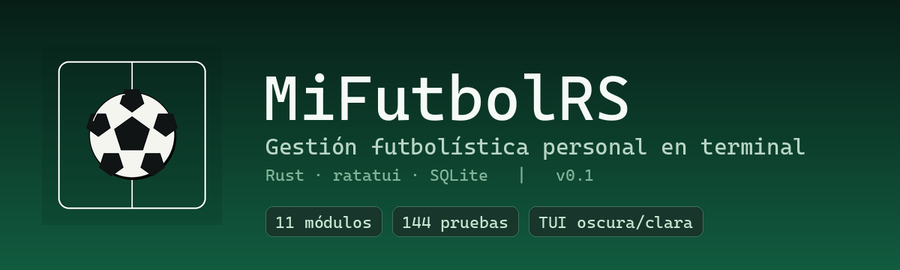
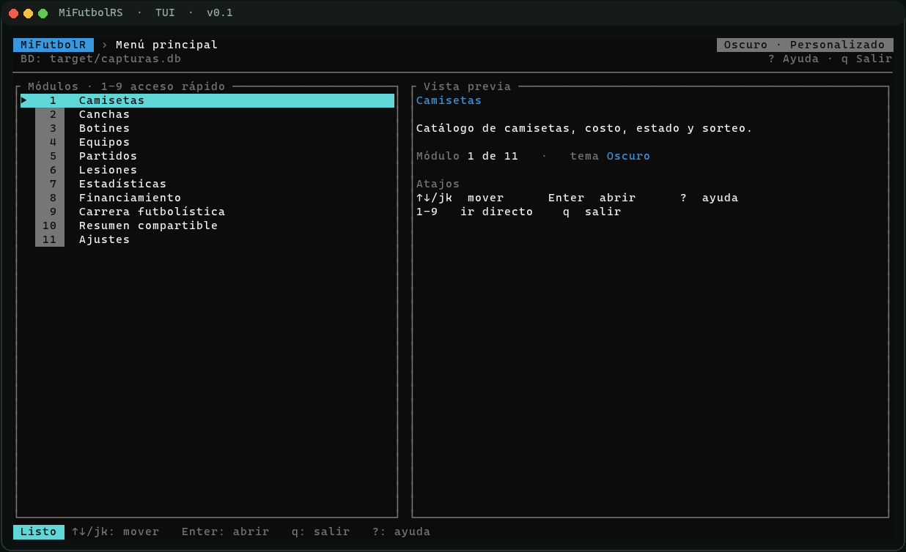
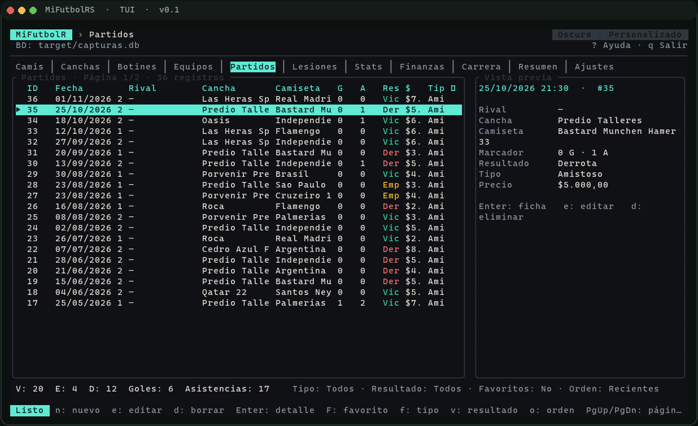
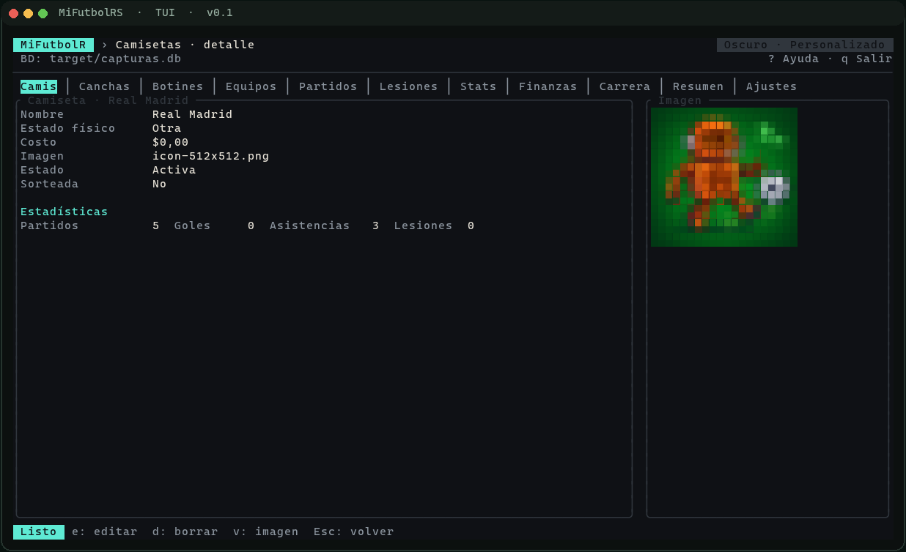
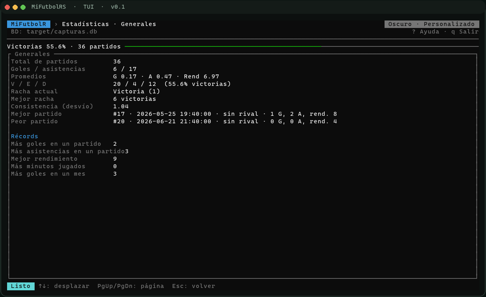
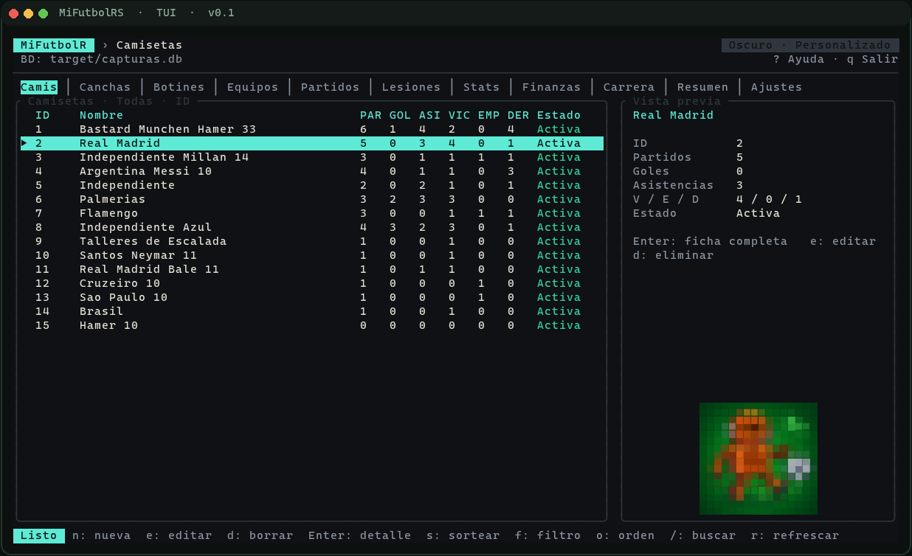
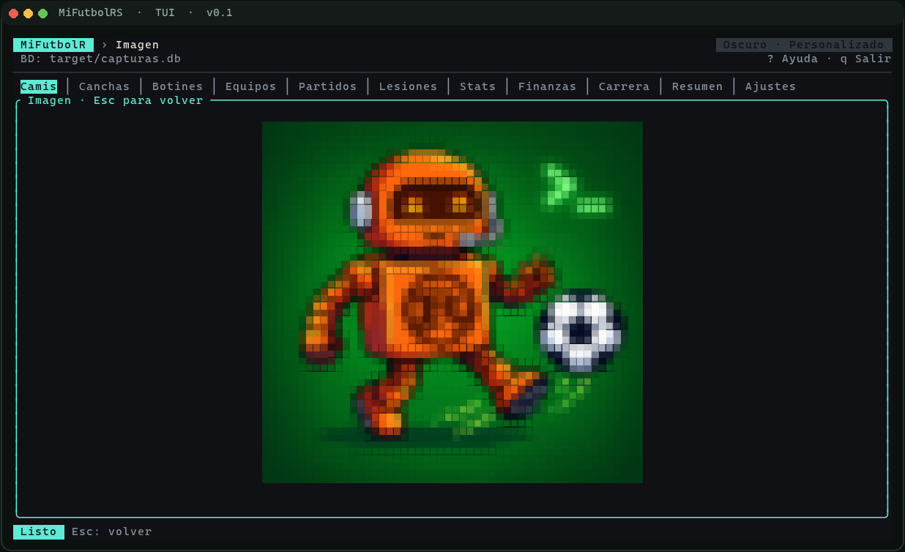
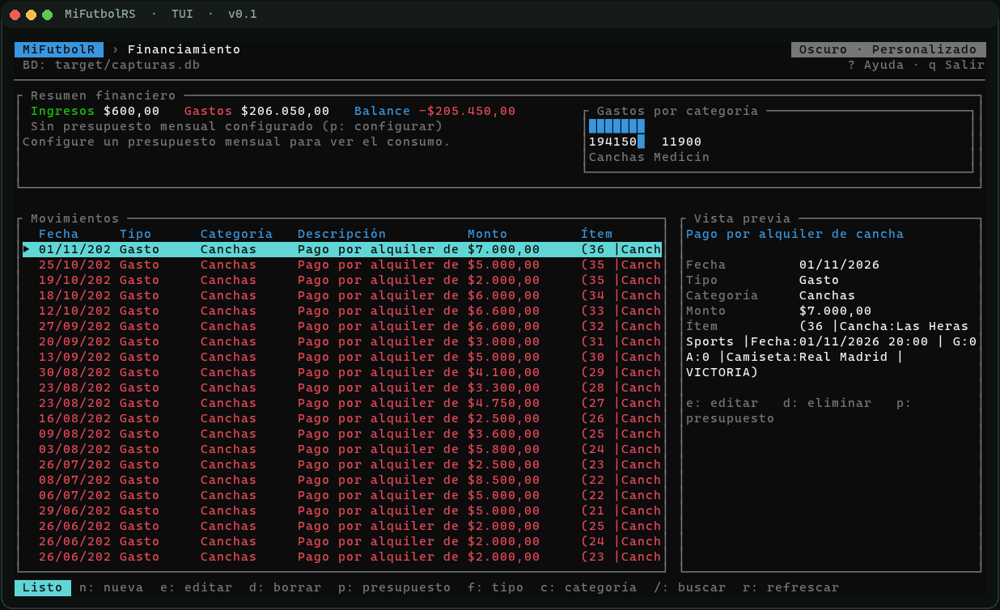
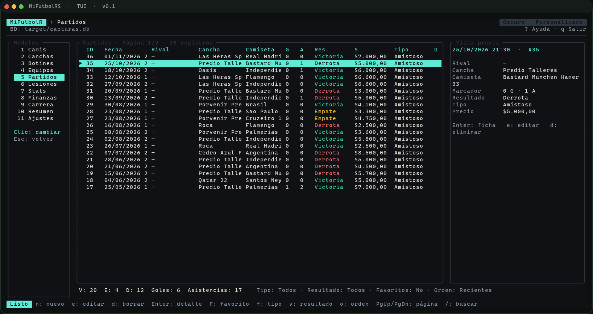

# MiFutbolR · v0.1



Gestión futbolística personal en terminal (Rust 2024 + rusqlite + ratatui).
Implementa la especificación de `skills/ESPECIFICACION_PROYECTO_RUST_TUI.md`
aplicando las prácticas de `skills/Performance.md`.

## Capturas

| Menú principal | Partidos con vista previa |
|---|---|
|  |  |
| **Ficha con imagen** | **Estadísticas** |
|  |  |
| **Listado con miniatura** | **Visor de imagen** |
|  |  |
| **Financiamiento** | |
|  | |


**Panorama en pantallas anchas (sidebar persistente):**



Las capturas se generan desde la TUI real con
`cargo run --example capturar_tui` y `python scripts/render_capturas.py`.

## Características

- **Menú principal como MiFutbolC**, numerado: 1 Calendario, 2 Camisetas, 3 Canchas,
  4 Botines, 5 Equipos, 6 Partidos, 7 Lesiones, 8 Estadísticas, 9 Logros,
  10 Financiamiento, 11 Torneos, 12 Temporada, 13 Análisis (Básico, Comparador
  A/B, Entrenador IA, Química y Evolución temporal), 14 Bienestar, 15 Carrera Futbolística, 16 Recordatorios,
  17 Colecciones, 18 Records & Rankings, 19 Tiendas, 20 Referencias Multimedia,
  21 Tutorial, 22 Resumen Compartible, 23 Ranking Amigos, 24 Ajustes,
  25 Sincronización (PocketBase); extras de MiFutbolR: 26 Progresión,
  27 Entrenador IA, 28 Usuario; 0 Salir.
  - Se abre tecleando el número: `3` abre en el acto, `1` espera un instante por si
    sigue otra cifra (`15`), Enter abre lo tecleado. `0`, `q` o Esc piden confirmar
    la salida (también en la portada; `i` entra como invitado).
  - Ajustes → **Modo de menú**: *Simple* (por defecto, como C) muestra Calendario,
    Camisetas, Canchas, Botines, Partidos, Lesiones, Tutorial, Ajustes,
    Sincronización y Usuario;
    *Avanzado* muestra todo; *Personalizado* oculta los menús con `enabled = 0` en
    `custom_menus` (claves de MiFutbolC), que se editan en Ajustes → `Ctrl+N`
    (Enter/Espacio alterna `[X]`/`[ ]`; Ajustes siempre se ve). Los números no
    cambian al filtrar.
  - Los atajos de letra (`c` calendario, `l`/`L` logros, `R` récords, `t` tutorial,
    `C` comparador, `T`, `U`, `E`, `D`, `A`, `M`, `Y`, `P`, `n`) solo valen en el
    menú; `g`, `!`, `?`, Ctrl+F y Ctrl+K siguen siendo globales.
  - Al entrar con la base vacía, si hay un backup con datos en `Exportaciones/`,
    se ofrece restaurarlo (S/N), una vez por sesión.
  - Al arrancar, como `main.c`, una vez por base al entrar al menú:
    *backup de inicio* si la base tiene datos
    (`Exportaciones/backup_<AAAAMMDD_HHMMSS>_inicio.db`, `_inicio_u<id>` por
    cuenta; el del mismo día se reemplaza y quedan los últimos 7 días, como el
    historial de C), *comprobar actualizaciones* una vez por día (marca
    `update_check.stamp`; consulta `releases/latest` de GitHub en segundo plano y
    solo avisa si hay una versión más nueva que `CARGO_PKG_VERSION`, con el
    enlace: no descarga ni instala nada) y el aviso de *Modo Retro* si hoy hay
    partidos de la misma fecha en años anteriores (S abre Carrera → Modo retro).
- **Análisis** (port de `analisis.c`): *Básico* compara los últimos 5 partidos con
  el promedio (goles, asistencias, rendimiento, cansancio, ánimo), rachas y mensaje
  motivacional; *Evolución temporal* muestra promedios por mes con gráfico de barras
  (`m` cambia la métrica), mejor/peor mes, inicio vs fin de año, meses fríos vs
  cálidos y progreso total; *Química* calcula la mejor dupla desde los equipos
  asignados a partidos y lista/edita duplas cargadas a mano (`n`/`e`/`d`).
- **Bienestar**: hábitos, entrenamientos, comidas, sesiones mentales y perfil de
  salud; el asistente (`a`) calcula preparación y riesgo de lesión y sugiere una
  rutina semanal (fórmulas de MiFutbolC).
- **Lesiones**: `u` avanza el estado de la lesión elegida (Activa → En tratamiento →
  Mejorando → Recuperado; una recuperada pasa a Recaída) y `D` muestra los días
  entre lesiones consecutivas con el promedio (`lesion.c`).
- **Camisetas**: borrar una camiseta con partidos o lesiones la desactiva (como C);
  `a` en el listado o la ficha la reactiva o desactiva, y `f` filtra activas/inactivas.
- **Colecciones**: inventario de camisetas, botines y accesorios agrupado en
  colecciones; `s` sincroniza las camisetas cargadas. `x` exporta el backup JSON
  de C (`Exportaciones/colecciones_inventario.json`) e `i` lo importa desde
  `Importaciones/`, uniendo con lo existente sin duplicar (colección por nombre,
  camiseta por id, ítem genérico equivalente).
- **Entrenador IA**: consejos por reglas a partir de los últimos 10 partidos,
  predicción del próximo resultado, formación sugerida, descanso y puntos débiles.
- **Clima automático**: si la cancha tiene latitud/longitud, el clima histórico
  del partido se pide a Open-Meteo en segundo plano (hasta 8 reintentos; `c` en
  Partidos encola los que faltan). Sin conexión, la app funciona igual.
- **Informes**: en Ajustes, `Ctrl+P` exporta un informe PDF y `Ctrl+O` una hoja
  de cálculo ODS (LibreOffice/Excel) a la carpeta Exportaciones.
- **Exportar / Importar** (Ajustes → `Ctrl+D`): una lista con todo lo de los menús
  de exportar e importar de C — exportar todo (JSON + Markdown), XLSX (un libro
  OOXML con partidos, equipos, canchas, camisetas, lesiones y torneos), ODS, PDF,
  copia de la base, MiFutbolMobile, base legacy y partidos del móvil. Los atajos
  `Ctrl+X/O/P/E/W/L/Y/A` de Ajustes siguen funcionando.
- **Importar JSON / TXT / CSV / HTML** (port de `import.c`): lee
  `Importaciones/camisetas.<ext>`, `partidos.<ext>` y `lesiones.<ext>` en los
  formatos que escribe MiFutbolC (con la columna "Atajaste" y los textos
  `VICTORIA`, `Mucho Calor`, `Noche`...). Hace un backup previo
  (`backup_*_pre_import.db`), importa todo en una transacción sin entrar al
  deshacer y muestra por archivo cuántas filas entraron, cuántas se omitieron
  (duplicadas: mismo id de camiseta/lesión o misma cancha+fecha+camiseta del
  partido; camiseta inexistente) y qué líneas estaban mal formadas. La cancha
  de un partido se crea si falta; la lesión usa la camiseta `camiseta` del JSON
  o la primera activa. Las "estadísticas" de C no se importan (MiFutbolR las
  calcula de los partidos).
- **Inicio de sesión multiusuario**: portada de MiFutbolR al iniciar para entrar o
  registrarse con o sin contraseña; cada cuenta usa su propia base de datos
  (también se puede continuar como invitado).
- **TUI ratatui**: header con breadcrumb, paneles redondeados con padding,
  tablas con vista previa lateral, formularios con iconos de tipo, wizard de
  partidos en 4 pasos, modales, temas y búsqueda incremental.
- **Diseño**: paleta RGB de 8 temas, barra de módulos con `Tabs`, **sidebar clicable** en pantallas ≥140 columnas, tipografía grande en el menú
  (`tui-big-text`) y estilos reutilizables (`Palette::panel`).
- **Interactividad**: navegación por teclado y rueda del ratón (scroll), filtros,
  formularios y visor de imágenes.
- **Imágenes**: el menú incluye el logo embebido; las fichas y listados de camisetas,
  canchas y equipos muestran miniaturas con
  `ratatui-image` (protocolo halfblocks); `v` abre un visor a pantalla completa.
- **Animaciones**: fundidos al cambiar de pantalla, modales y un pulso sutil
  en la fila seleccionada con
  `tachyonfx`; se desactivan en capturas y tests visuales.
- **SQLite embebido**: migraciones `PRAGMA user_version`, WAL, claves foráneas,
  índices y seeds.
- **Partidos**: filtros, paginación, favoritos, derivados y transacción
  financiera automática.
  `s` simula un partido con dos equipos guardados (`simular_partido_guardados`
  de C: 60 minutos, goles y asistencias al azar entre los jugadores, relato y
  estadísticas; no se guarda). En cualquier reporte de texto `x` lo exporta a
  `Exportaciones/reporte_<fecha>.txt`.
- **Estadísticas**: generales, series, 20 métricas de rendimiento, canchas,
  goles/asistencias, sparkline y `LineGauge`/`BarChart`. Como `estadisticas.c`
  suma *Ánimo, clima y cansancio* (goles y asistencias por estado de ánimo,
  asistencias por clima, momento y cansancio, mejor/peor clima y día, ánimo
  ideal, partidos con cansancio alto y caída por cansancio acumulado), *Tabla de
  posiciones global* (PJ/PG/PE/PP/GF/GC/DG/Pts con desglose por año; usa el
  marcador del equipo si está cargado), *Filtros avanzados* (fechas, resultado y
  cancha, con resumen) y *Reportes automáticos* (genera
  `Exportaciones/reporte_general_<fecha>.html` o `rendimiento_<fecha>.txt` y
  lista los generados, tabla `reporte_generado`).
- **Carrera**: identidad, hitos, rachas, badges, timeline, Hall of Fame,
  perfil dinámico, modo retro y logros.
- **Resumen Compartible**: Markdown/HTML/texto con vista previa y exportación.
- **Ajustes**: tema, idioma, modo, tamaño, visor, botín predeterminado, buscar
  actualizaciones al iniciar, backup, exportación, integridad y restauración en
  vivo. *Idioma* English traduce el menú principal, "Salir" y las etiquetas de
  Ajustes con las claves de `langs/en.json` de C (el español es el defecto).
  `Ctrl+U` busca actualizaciones, `Ctrl+F` muestra la configuración actual (sin
  contraseñas ni token) y `Ctrl+Q` la restablece a los valores por defecto
  (confirmación; los menús personalizados se conservan). `Ctrl+G` administra los backups
  (`backup_*.db` con fecha, tamaño y partidos; Enter restaura el elegido, `d` lo
  elimina, `b` crea otro; ambas con confirmación). `Ctrl+T` hace el mantenimiento
  de la base (backup previo, VACUUM, ANALYZE, `integrity_check` y
  `foreign_key_check`) y `Ctrl+X` exporta todo: un `.json` con todas las tablas de
  usuario (sin undo ni credenciales) y un `.md` con partidos, camisetas, canchas,
  botines, lesiones, financiamiento y torneos.
- **Sincronización (PocketBase)** (port de `sync.c`): configurar URL local
  (Wi-Fi) y remota (HTTPS), iniciar sesión (se guarda solo el token, nunca la
  contraseña), sincronizar ahora o subir todo el historial, ver pendientes y
  conflictos, resolverlos (local o servidor) y activar la auto-sync al iniciar,
  que corre en segundo plano sin frenar la TUI. Sube y baja partidos
  (`partidos_sync`), camisetas (`camisetas_sync`) y botines (`botines_sync`);
  gana la marca más nueva y, si un partido cambió en los dos lados, queda un
  conflicto. Ni el token ni la cola salen en "Exportar todo".
- **MiFutbolMobile**: en Ajustes, `Ctrl+W` exporta
  `Exportaciones/mifutbolmobile_import.json` (formato `mifutbolmobile-import` v1
  de MiFutbolC) y `Ctrl+Y` importa `Importaciones/partidos.json` del móvil (sin
  duplicar). `Ctrl+A` activa el marcador `Importaciones/.sync_partidos_auto`: al
  iniciar se importa ese archivo y se renombra a `partidos_importados_<fecha>.json`.
- **Migración legacy**: importa una base de MiFutbolC convirtiendo fechas,
  importes y códigos de cancha; ignora tablas vacías/no usadas como `amigo`.
- **Torneos**: alta, equipos automáticos, fixture ida/vuelta, resultados y tabla de posiciones.
- **Meta-análisis**: consistencia, outliers, contexto, impacto del cansancio/ánimo y eficiencia.
- **Progresión**: planes de entrenamiento y evolución semanal por jugador.
- **Recordatorios**: recurrencia diaria/semanal/mensual, agenda con partidos y calendario.
  `f` filtra por temática (recorre las existentes), `x` exporta
  `Exportaciones/recordatorios.json` e `i`/`I` importa
  `Importaciones/recordatorios.json` uniendo o reemplazando (con backup previo),
  en el formato de `recordatorios.c` (`fecha_fin` no se guarda).
- **Multimedia**: video, foto, artículo y audio asociados a partidos, con filtro por tipo.
- **Tiendas y amigos**: catálogo de tiendas y ranking de amigos con el usuario local.
- **Temporadas**: fases, torneos asociados, resumen del rango, fatiga y comparación.
- **Comparador A/B**: camisetas y canchas lado a lado con 9 métricas y ganador por métrica.
- **Estadísticas de canchas**: 10 reportes (más/menos usadas, rendimiento, goles/asistencias, tipo, superficie, techada, localidad y franja).
- **Ola 0**: panel "Hoy", calendario mensual, búsqueda global (Ctrl+F), paleta (Ctrl+K),
  logros (65), récords/rankings (16 reportes), notificaciones, undo (Ctrl+Z), tutorial y
  exportación de listados a CSV/JSON/HTML/Markdown.
- **Plan de evolución**: [docs/ANALISIS_MIFUTBOLC.md](docs/ANALISIS_MIFUTBOLC.md) analiza MiFutbolC y propone 32 mejoras con su implementación.

## Instalación en Windows

El instalador está en `dist/MiFutbolR-Setup-0.1.exe` (Inno Setup):

- Instala MiFutbolR en `{autopf}\MiFutbolR` (Program Files).
- Crea un acceso directo en el **menú Inicio**.
- Permite crear opcionalmente un acceso directo en el **escritorio**.
- Usa el icono `assets/icono.ico`.
- Permite **iniciar el programa** al finalizar la instalación.
- Incluye el **desinstalador** de Windows.

La base de datos de usuario se guarda en
`%LOCALAPPDATA%\mifutbol\mifutbol-rs\data\mifutbol.db` y no se elimina al
desinstalar.

Para migrar los **perfiles de MiFutbolC** (`users.db` + `mifutbol_<usuario>.db`), cada uno
como cuenta con su propia base y la misma contraseña:

```powershell
.\mifutbol-rs.exe --importar-perfiles            # usa %LOCALAPPDATA%\MiFutbolC\data
.\mifutbol-rs.exe --importar-perfiles "D:\otra\carpeta\data"
```

o desde la portada con la tecla **m**. Los archivos de MiFutbolC se abren en solo lectura;
los perfiles cuyo nombre ya existe se omiten con un aviso. La contraseña heredada se
convierte al formato de MiFutbolR en el primer inicio de sesión.

Para migrar una base legacy:

```powershell
.\mifutbol-rs.exe --importar-legacy "C:\ruta\mifutbol.db"
```

o desde la TUI: **Ajustes → Ctrl+L**. Detalle en
[`docs/MIGRACION_BD.md`](docs/MIGRACION_BD.md).

## Requisitos

- Rust estable (probado con 1.99; edición 2024, MSRV 1.88).
- Toolchain C para SQLite embebido (MSVC Build Tools en Windows).

## Comandos

```bash
cargo run                    # abre la TUI (crea la BD si no existe)
cargo test                   # unitarias + integración
cargo nextest run            # pruebas con nextest
cargo clippy --all-targets -- -D warnings
cargo fmt --check
cargo build --release        # opt-level 3, lto thin, strip
cargo bench --bench queries  # benchmarks de consultas
cargo audit                  # vulnerabilidades
cargo deny check             # licencias/bans (deny.toml)
cargo bloat --release --crates
cargo expand --lib
```

### Análisis completo

[`scripts/analizar.ps1`](scripts/analizar.ps1) ejecuta todo el toolchain y
genera logs + reporte en `target/analisis/`:

```powershell
.\scripts\analizar.ps1              # análisis rápido
.\scripts\analizar.ps1 -Completo    # pruebas release + audit/deny/bloat/expand
```

Última ejecución: **17 pasos, 0 fallos**; 157 pruebas; `cargo audit` y
`cargo deny` sin hallazgos.

## Datos

| SO | Ruta por defecto |
|----|------------------|
| Windows | `%LOCALAPPDATA%\mifutbol\mifutbol-rs\data\mifutbol.db` |
| Linux | `~/.local/share/mifutbol-rs/mifutbol.db` |
| macOS | `~/Library/Application Support/com.mifutbol.mifutbol-rs/mifutbol.db` |

Esa es la BD de invitado. Las cuentas se registran en `cuentas.db` y cada una
guarda sus datos en `usuarios/<id>/mifutbol.db`, dentro del mismo directorio.
Eliminar una cuenta no borra su archivo de datos.

`MIFUTBOL_DB` permite apuntar a otro archivo (BD de invitado). Exportaciones,
backups e imágenes viven junto a la BD.

## Arquitectura

```
ui (ratatui) → app (pantallas/teclado/estado) → services (reglas) → db (SQL)
                              domain (modelos, dinero, fechas, stats, plantillas)
```

- Dinero en centavos (`Cents`); fechas ISO en BD y `DD/MM/YYYY` en UI.
- La UI nunca ejecuta SQL ni lógica de negocio.
- PRAGMAs: `foreign_keys=ON`, `journal_mode=WAL`, `synchronous=NORMAL`,
  `temp_store=MEMORY`.

## Calidad y rendimiento

- **157 pruebas** verdes (nextest: 144 passed en ~2 s).
- `clippy --all-targets -- -D warnings` y `cargo fmt --check` limpios.
- CI multiplataforma (Ubuntu, Windows, macOS): fmt, clippy, tests y release.
- Benchmarks Criterion sobre 10.000 partidos: listado ≈ 215 µs, búsqueda
  ≈ 640 µs, conteo ≈ 0,99 ms, estadísticas completas ≈ 71 ms.
- Sin `unwrap`/`expect`/`panic!` en código de producción (solo tests).

## Instalador (Inno Setup)

El script [`MiFutbolR.iss`](MiFutbolR.iss) compila el instalador:

```powershell
& "C:\Program Files (x86)\Inno Setup 6\ISCC.exe" MiFutbolR.iss
```

Salida: `dist/MiFutbolR-Setup-0.1.exe`. También se genera un ZIP portable en
`dist/MiFutbolR-0.1-win64.zip`.

## Estado

M0–M12 completados y TUI mejorada. La base local fue migrada desde
`mifutbol.db`; las tablas legacy vacías (como `amigo`) quedaron fuera por no
ser utilizadas. Detalle de la checklist en
[`docs/PLAN_IMPLEMENTACION.md`](docs/PLAN_IMPLEMENTACION.md) y evidencia en
[`docs/ACEPTACION.md`](docs/ACEPTACION.md).
